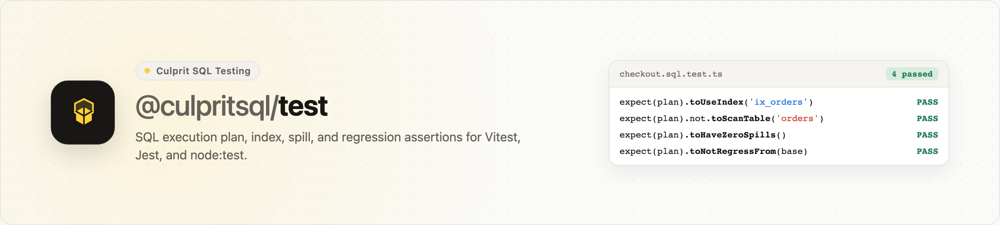

<div align="center">

<picture>
  <source media="(prefers-color-scheme: dark)" srcset="https://raw.githubusercontent.com/culpritsql/culprit-test/main/assets/hero-dark.png">
  <source media="(prefers-color-scheme: light)" srcset="https://raw.githubusercontent.com/culpritsql/culprit-test/main/assets/hero-light.png">
  
</picture>

<br />

[](https://www.npmjs.com/package/@culpritsql/test)
[](https://www.npmjs.com/package/@culpritsql/plans)
[](https://www.npmjs.com/package/@culpritsql/test?activeTab=dependencies)
[](https://github.com/culpritsql/culprit-sql-studio)
[](./LICENSE)

**Execution plan regression assertions, Vitest/Jest matchers, and safe `EXPLAIN` runners for CI.**
<br />
Powered by [`@culpritsql/plans`](https://github.com/culpritsql/culprit-plans) and paired with [`@culpritsql/plan-viewer`](https://github.com/culpritsql/culprit-plan-viewer).

[Quickstart](#quickstart) · [Matchers](#matchers) · [Supported Drivers](#supported-drivers) · [Standalone Assertions](#standalone-assertions) · [Safety & Security](#safety--security)

</div>

---

## Quickstart

```sh
npm install -D @culpritsql/test
```

Register `culpritMatchers` once in your Vitest, Jest, or Bun test setup, then assert directly against live `EXPLAIN` queries from raw SQL, **Reylo** `.sql` modules, or **Drizzle / Kysely / Knex** builders:

```ts
import { expect, test } from "vitest";
import { culpritMatchers, explain, explainText } from "@culpritsql/test";
import getRecentOrders from "./queries/getRecentOrders.sql";

expect.extend(culpritMatchers);

test("checkout orders query uses composite index without spills", async () => {
  // Works with Reylo { sql } modules, Drizzle/Kysely .toSQL(), or raw SQL strings
  const plan = await explain(pgPool, getRecentOrders, ["shipped"], {
    analyze: true, // Runs EXPLAIN (ANALYZE, BUFFERS, FORMAT JSON) inside BEGIN READ ONLY ... ROLLBACK
  });

  expect(plan).toUseIndex("orders_status_created_idx");
  expect(plan).not.toScanTable("orders");
  expect(plan).toHaveZeroSpills();
  expect(plan).toHaveZeroWarnings();
  expect(plan).toReadAtMostPages(250);
});

test("candidate plan does not regress from golden baseline", async () => {
  const baseline = await explainText(baselinePlanJson, "postgres");
  const candidate = await explain(
    pgPool,
    db.select().from(orders).where(eq(orders.status, "shipped")).limit(20),
  );

  expect(candidate).toNotRegressFrom(baseline, { maxCostRatio: 1.2 });
});
```

---

## Matchers

Every matcher supports `.not` negation and prints rich failure diagnostics with the offending node ID, operator, target relation, row estimates/actuals, and engine index hints.

| Matcher | Inspects | Typical CI Guard |
| --- | --- | --- |
| `toUseIndex(name?: string \| RegExp)` | `Index Scan`, `Index Seek`, `Index Only Scan`, `Bitmap Index Scan`, MySQL index lookups, SQLite `SEARCH ... USING INDEX` | `expect(plan).toUseIndex("orders_customer_idx")` |
| `toScanTable(table?: string \| RegExp)` | `Seq Scan`, `Table Scan`, `Clustered Index Scan`, MySQL `ALL`, SQLite `SCAN` without index | `expect(plan).not.toScanTable("orders")` |
| `toHaveZeroSpills()` | `runtime.spill_pages`, `facts.sort_on_disk`, `facts.exchange_spill`, hash batches, disk sort properties, and `"spill"` warnings | `expect(plan).toHaveZeroSpills()` |
| `toCostLessThan(maxTotalCost)` | `plan.total_cost` | `expect(plan).toCostLessThan(500)` |
| `toCompleteWithin(maxElapsedMs)` | `plan.facts.elapsed_ms` (measured runtime) | `expect(plan).toCompleteWithin(25)` |
| `toReadAtMostPages(maxLogicalReads)` | Total `runtime.logical_reads` across all plan nodes | `expect(plan).toReadAtMostPages(100)` |
| `toHaveZeroWarnings()` | `plan.warnings`, node warnings, and `facts.conversions` (`CONVERT_IMPLICIT` / seek-blocking casts) | `expect(plan).toHaveZeroWarnings()` |
| `toNotRegressFrom(baseline, opts?)` | Structural `diffPlans()` access-path flips (`seek` to `scan`) and `cost_ratio` spikes | `expect(plan).toNotRegressFrom(baseline)` |

---

## Supported Drivers

`@culpritsql/test` carries **zero database driver dependencies**. It inspects structural client capabilities at runtime or respects an explicit `options.engine` override:

| Engine | Client Libraries | Default Command | With `{ analyze: true }` |
| --- | --- | --- | --- |
| **PostgreSQL & YugabyteDB** | `pg` (`Pool` / `Client`), `postgres.js`, `Bun.sql` | `EXPLAIN (FORMAT JSON)` | `EXPLAIN (ANALYZE, BUFFERS, FORMAT JSON)` inside `BEGIN READ ONLY ... ROLLBACK` |
| **MySQL & MariaDB** | `mysql2/promise` (`Pool` / `Connection`) | `EXPLAIN FORMAT=JSON` | `EXPLAIN ANALYZE` |
| **SQLite** | `better-sqlite3`, `node:sqlite`, `bun:sqlite`, LibSQL, Cloudflare D1 | `EXPLAIN QUERY PLAN` (formatted to tree text) | `EXPLAIN QUERY PLAN` |
| **SQL Server** | Offline `.sqlplan` XML via `explainText(xml, "mssql")` | Native Showplan XML | Actual Showplan XML (`RunTimeInformation`) |

### Query Input Adapters

- **Raw SQL**: `explain(pool, "SELECT * FROM orders WHERE customer_id = $1", [42])`
- **Named Parameters**: `explain(pool, "SELECT * FROM orders WHERE status = :status", { status: "shipped" })`
- **Reylo `.sql` Modules**: `explain(pool, { sql: "SELECT * FROM orders WHERE id = $1" }, [42])`
- **Drizzle / Kysely / Knex**: `explain(pool, queryBuilder)` (automatically extracts `.toSQL()`)

---

## Standalone Assertions

Running outside Vitest or Jest (for example in `node:test`, custom migration gates, or CI scripts)? Use `assertPlan(plan)` for a zero-framework fluent API:

```ts
import { assertPlan, explainText } from "@culpritsql/test";

const plan = await explainText(sqlplanXml, "mssql");

assertPlan(plan)
  .toUseIndex("ix_customers_email")
  .not.toScanTable("customers")
  .toHaveZeroSpills()
  .toHaveZeroWarnings()
  .toCostLessThan(1.0);
```

---

## Safety & Security

- **Read-only rollback protection**: On PostgreSQL and YugabyteDB, `{ analyze: true }` pins a dedicated session (`pool.connect()`, `sql.reserve()`, or `sql.begin()`) and wraps `EXPLAIN (ANALYZE, BUFFERS, FORMAT JSON)` inside `BEGIN READ ONLY ... ROLLBACK`. Drivers without session-pinned transaction control are refused unless `{ allowMutatingAnalyze: true }` is set explicitly.
- **Single-statement SQL guard**: A lexical SQL scanner validates non-empty queries and rejects multi-statement `;` injection attempts while leaving quoted strings, PostgreSQL `$$` dollar quotes, `::type` casts, and SQL comments intact.
- **Hardened WebAssembly parser**: Plan and diff operations run inside `@culpritsql/plans` with deterministic XML/JSON depth bounds and XXE/DTD refusal.

## License

MIT.
